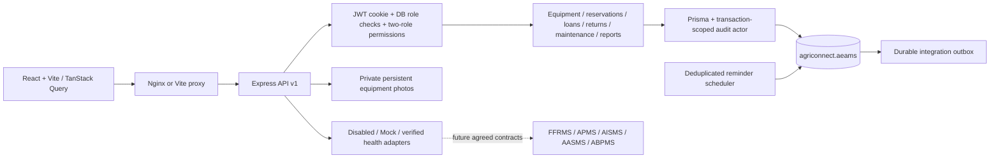

# Application architecture

The React frontend routes all requests through `/api/v1`, displays backend errors/loading/empty states, and uses TanStack Query invalidation after mutations. Forms use React Hook Form; login uses Zod validation and server endpoints validate all submitted fields with Zod. Shared Radix/shadcn-style dialog/button primitives provide consistent interactions. Chart values and tables come from database-backed endpoints.

`backend/src/app.ts` configures security headers, request IDs, CORS, rate limits, cookie login, session validation and error handling. `routes.ts` contains domain HTTP operations, permission checks and staff permission checks. `reports.ts` handles bounded report queries, CSV/PDF and receipts. `notifications.ts` coordinates transaction notifications and advisory-locked deadline reminders. `integrations.ts` separates mock/disabled configuration from verified remote health checks.

Operational mutations run through Prisma transactions with a local audit actor/request ID. Database triggers serialize equipment changes and maintain a protected shared booking projection. PostgreSQL exclusion constraints reject overlapping approved reservations, borrowing and maintenance windows even across independent connections. Returns require immutable inspection evidence. Application permissions complement, rather than replace, these invariants.

The runtime identity cannot migrate or mutate audit/projection tables directly. Admin/Employee authorization stays in the trusted API. Farmer records remain references to FFRMS; fallback authorization is explicit, bounded and audited. External inventory, eligibility and financial records remain under their respective ERP owners.

Outbox events commit with local domain changes. Automatic remote delivery, central ERP sign-on, live farmer synchronization and module-specific operation endpoints remain contract work with the other teams. Live connectivity is never inferred from a mock or a configured URL.
