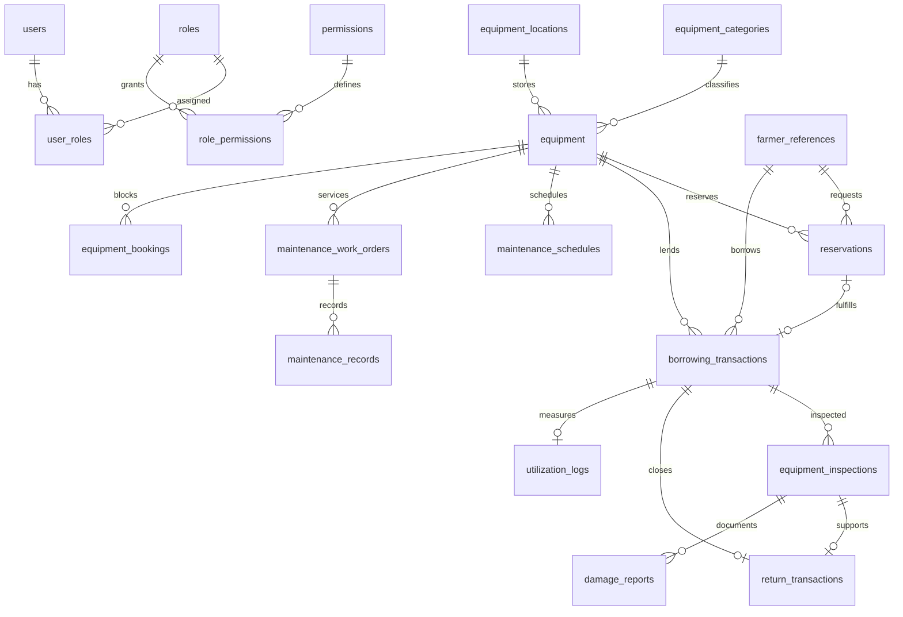

# Centralized PostgreSQL database

AgriConnect uses one PostgreSQL infrastructure and one database, `agriconnect`, with a schema owned by each module. This implementation provisions **only `aeams`**. It does not create other teams' tables or claim their services are connected.

| Module | Planned schema | Authoritative data |
| --- | --- | --- |
| FFRMS | `ffrms` | Farmers, farms, barangay and association references |
| APMS | `apms` | Production and agricultural activities |
| AISMS | `aisms` | Consumables, parts, stock and material issues |
| AASMS | `aasms` | Programs, beneficiary eligibility and assistance approvals |
| AEAMS | `aeams` | Durable equipment, reservations, loans, returns and maintenance |
| ABPMS | `abpms` | Budgets, procurement, acquisition and financial approvals |

Each team needs its own schema owner/migration login and restricted runtime login. Other modules must not connect with the PostgreSQL administrator or AEAMS migration account. Coordinate shared authentication subject formats with the ERP team; local `users.erp_subject` is an optional unique opaque reference to the future identity provider.

## Tables and relationships

The Prisma schema defines 27 tables. Every table has a UUID primary key and creation timestamp. Mutable tables have update timestamps enforced by PostgreSQL, including writes outside Prisma. Audit records are append-only and have no update timestamp.

| Area | Tables |
| --- | --- |
| Identity and authorization | `users`, `roles`, `permissions`, `user_roles`, `role_permissions` |
| Durable assets | `equipment`, `equipment_categories`, `equipment_locations`, `equipment_images` |
| Borrower references | `farmer_references` |
| Equipment operations | `reservations`, `borrowing_transactions`, `equipment_inspections`, `return_transactions` |
| Maintenance | `maintenance_schedules`, `maintenance_work_orders`, `maintenance_records`, `damage_reports` |
| Accountability | `utilization_logs`, `notifications`, `audit_logs`, `system_settings` |
| ERP integration | `external_module_references`, `integration_connections`, `integration_events`, `integration_outbox` |
| Internal calendar projection | `equipment_bookings` |

Money uses fixed precision decimals in PHP; this module has no exchange-rate logic. Timestamps use `timestamptz(3)` and represent instants; acquisition/warranty dates use `date`. Send ISO 8601 timestamps with an offset and display them in `Asia/Manila`. Do not parse Philippine local times as UTC accidentally.

## Integrity and availability

The initial Prisma-generated migration creates tables, foreign keys, unique constraints and indexes. The second SQL migration adds PostgreSQL-specific checks, actor foreign keys, workflow triggers, auditing and views. The third grants runtime privileges when the DBA-provisioned `aeams_app` role exists.

`equipment_bookings` is an internal projection maintained atomically by triggers. A GiST exclusion constraint rejects intersecting date ranges for the same equipment across **all** reservation, borrowing and maintenance records. Half-open `[start,end)` windows permit adjacent bookings. The `btree_gist` extension supplies UUID equality indexing. Operational changes lock the equipment row before changing the projection. The runtime role cannot write the projection directly.

Approved reservations and approved loans block their requested windows. Scheduled maintenance blocks its scheduled window. A released/overdue loan or maintenance in progress blocks from its start through **an unbounded end** until explicitly returned or closed. This deliberately conservative policy protects equipment still physically unavailable after a deadline. It also means an active loan prevents approving future reservations, and a future commitment can prevent an earlier loan's release/in-progress maintenance until that commitment is rescheduled or cancelled. Review this conservative policy with the MAO before live use.

An approved borrowing linked to a reservation must use the same equipment, borrower and a contained date range. Its approval fulfills the reservation and transfers the calendar block in one transaction. Cancelling that borrowing releases the block; it does not revive the fulfilled reservation. Create a new reservation when necessary. Committed workflow dates and borrower/equipment references are immutable; cancel and create a replacement request to change them.

The database rejects skipped workflow transitions, approvals without approvers, releases without a usable release condition, expired borrower verification, and requests for archived equipment. Equipment with bookings cannot be archived. Equipment and operational history cannot be hard-deleted by application code. Inspection, return and maintenance-record corrections require a new corrective record; the API/UI correction workflow remains future work.

Insert the inspection and return inside one transaction. A return requires a matching released loan and an inspection at or after actual return. The return trigger closes the loan and updates equipment condition atomically. Damage or missing accessories force a damaged condition even if the inspector selected `GOOD`. Damaged/unserviceable assets cannot be approved or released. Maintenance completion clears its calendar block; it does not implicitly certify damaged equipment as repaired. An authorized repair process must explicitly record and assess the new condition.

`maintenance_schedules` are recurring planning reminders. Actual downtime is reserved by `maintenance_work_orders`; reminder dates alone do not block the calendar. The backend sends due-date reminders; managers create actual work orders. Completing a linked work order advances its recurring due date.

Views expose live data:

* `equipment_availability`: current physical availability, condition and archive status.
* `overdue_borrowings`: active loans whose deadline has passed, without waiting for a status-update job.
* `dashboard_summary`: eight database-derived dashboard counts. Reserved equipment means reserved **now**; upcoming maintenance means active recurring schedules due in the next 30 days. These counts overlap in meaningful ways, e.g. overdue loans are also borrowed.

For a requested date window, query `equipment_bookings` with range overlap and exclude archived/damaged equipment. Current availability alone cannot answer future availability. Treat an availability read as advisory: the write-side constraint decides whether approval can commit.

## Access boundaries

`postgres` is the local DBA login. `aeams_migrator` owns the AEAMS schema and migration objects. `aeams_app` can read and write domain records but cannot create tables, hard-delete records, mutate audit history or write booking projections. It cannot read `_prisma_migrations`. Security-definer trigger functions use a fixed search path; PUBLIC execute access is revoked.

The runtime login is a **trusted backend service identity**, not a per-user account. The Express backend enforces JWT sessions, permission checks, the Admin/Employee permission boundary before sending database writes. Never distribute these credentials to browsers, farmers, external modules or desktop clients. The DBA and migration owner can change schema protections and must remain restricted.

`backend/src/database.ts` uses `APP_DATABASE_URL` and provides a transaction-scoped audit actor helper. Set the actor only after authentication/authorization. Without actor context, triggers still log changes with a null actor. Audit metadata contains entity/status information, not full farmer records, password hashes or credentials. These logs are application-level accountability records, not tamper-proof DBA monitoring.

The development fixture uses bcrypt cost 12 and randomized credentials from `.env`; there are no fixed production passwords. Object-storage keys are stored for photos. The API verifies image type/size and generated paths; malware scanning remains an infrastructure decision.

## Migration discipline

Use `npm run db:migrate` (`prisma migrate deploy`). Do not use `prisma db push` or reset a shared database: Prisma models do not represent the SQL exclusion constraint, views, additional actor FKs and triggers. Future schema changes need reviewed forward migrations that preserve those objects. Review generated diffs carefully; do not drop custom SQL constraints because a generator cannot express them.

The shared database extension must be installed by the DBA; local Docker initialization installs it. Existing shared servers should provision `aeams_migrator`, `aeams_app` and `aeams` in advance, grant the migration login ownership of its own schema, and keep module logins out of other teams' roles. The initialization script runs only against an empty PostgreSQL volume. Changing `.env` later does not rotate database passwords; use explicit DBA `ALTER ROLE` operations and coordinate consumer updates.

New migrations that introduce tables must add suitable explicit runtime grants. Default grants are deliberately omitted so new audit/security tables are not automatically writable by the application.

References: [Prisma multi-schema configuration](https://www.prisma.io/docs/orm/v6/prisma-schema/data-model/multi-schema), [PostgreSQL range and exclusion constraints](https://www.postgresql.org/docs/17/rangetypes.html).

Application migrations add account session versions, farmer-account links, deduplicated notifications and office settings. The verification trigger uses a wall-clock comparison with one millisecond of tolerance for timestamptz(3) rounding.

The Admin/Employee migration restricts application roles to two values and one assignment per user. It preserves historical account UUIDs, disables retired borrower-only portal access and the old extra demo logins, and keeps two active demo identities. Farmer references remain transaction data, not application accounts.
